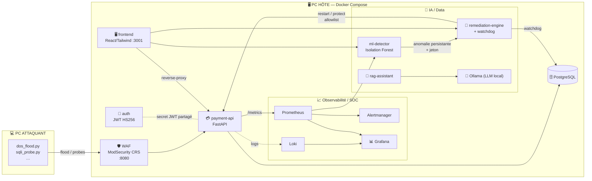
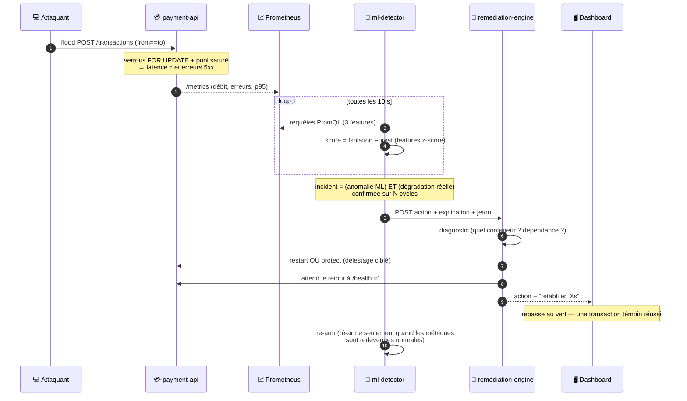
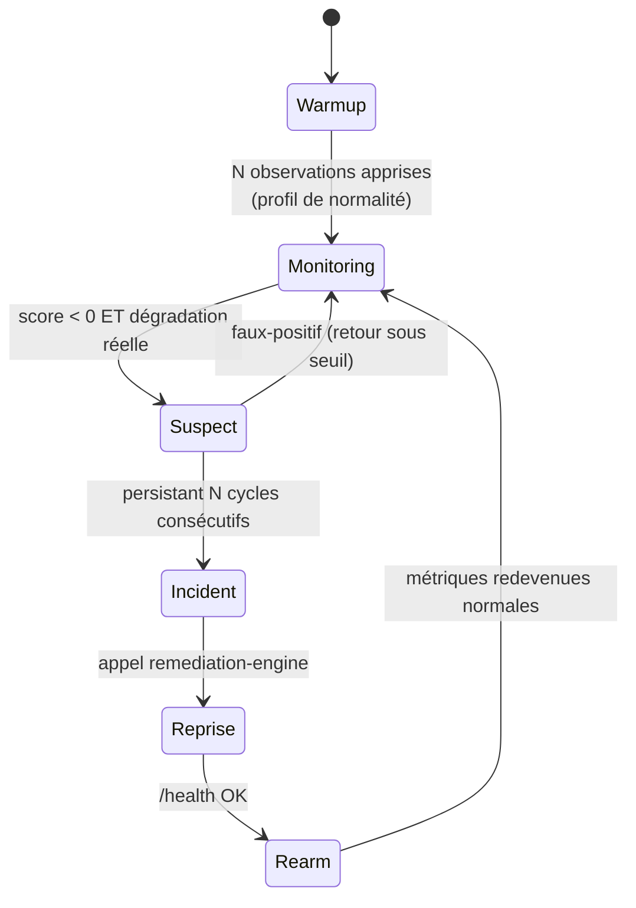
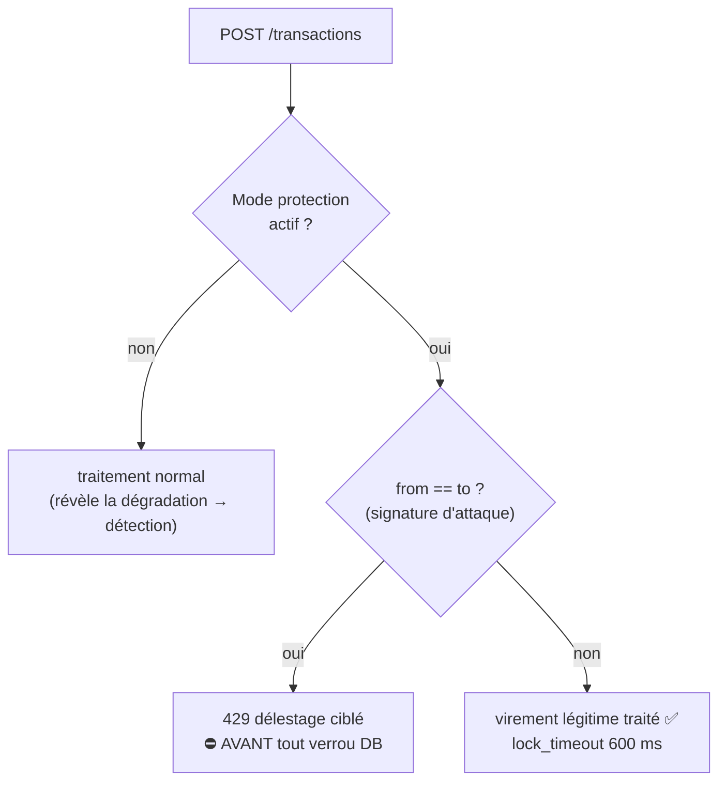

<div align="center">

# 🛡️ PROJECT RESILIENCE-ALPHA

### Démonstrateur de **cyber-résilience & reprise autonome** — *Zero-Touch Recovery*

*Une plateforme de paiement fictive qui se **défend**, se **diagnostique** et se **répare toute seule**.*


</div>

> ⚠️ **Environnement 100 % fictif.** Aucune donnée bancaire réelle. Les actions offensives
> sont strictement limitées au SI de l'équipe (sujet §9).

---

## 🎯 Le projet en 30 secondes

Une attaque lancée depuis un **poste distinct** provoque une **dégradation observable** de l'API de
paiement. La plateforme la **détecte** (IA non supervisée), **décide** de la bonne action
(playbook), **répare** le composant concerné, puis **vérifie** le retour à un état utilisable — le
tout **sans intervention humaine**. Toute la chaîne est **visible en direct** sur un dashboard de
supervision et dans Grafana.

Le fil rouge du projet : distinguer deux natures d'incident et y répondre différemment.

| Nature | Exemple | Réponse autonome |
|---|---|---|
| **Disponibilité** | DoS/DDoS, crash d'un conteneur, panne DB | On **rétablit** : redémarrage, délestage ciblé, diagnostic de dépendance |
| **Compromission** | Injection SQL, XSS, traversée de chemin | On **bloque en amont** (WAF) + alerte SOC — on n'« auto-répare » pas une fuite |

---

## 🗺️ Architecture



> Détail complet et choix justifiés : [`docs/architecture.md`](docs/architecture.md).

**Principe clé de sécurité** : le WAF est le **seul point d'entrée publié** de l'API. `db`, `auth`,
`prometheus`, `loki`, `ml-detector`, `remediation-engine` et `ollama` ne sont **jamais** exposés ;
le dashboard atteint les services internes via un **reverse-proxy nginx**.

---

## ⚙️ La chaîne détection → décision → reprise

C'est le cœur noté du projet. Voici le déroulé exact, de l'attaque à la preuve de rétablissement :



---

## 🔁 Le détecteur, vu comme une machine à états



Deux garde-fous importants :

- **Garde de dégradation** : une anomalie ML *seule* ne suffit pas. Il faut aussi une **dégradation
  réelle** (taux d'erreur / latence au-dessus d'un seuil). Sinon, un simple site inactif partirait
  en « anomalie ».
- **Re-arm latch** : après une reprise réussie, le moteur **ne ré-agit pas** tant que les métriques
  ne sont pas revenues à la normale → évite un second throttle parasite juste après la reprise.

---

## 🌊 Mitigation DDoS : le délestage **ciblé**

Problème classique du délestage naïf : un rate-limit **global** fait tomber aussi les clients
légitimes. Ici, sous protection, on rejette **tôt la signature d'attaque** (auto-virement net-nul,
`from == to`) **avant toute prise de verrou DB** — les virements légitimes (`from != to`) continuent
de passer.



> Résultat : **pendant un DDoS, on peut toujours payer** entre deux comptes différents, tandis que
> le flood est absorbé à coût quasi nul. La dégradation reste visible hors protection, donc la
> détection se déclenche toujours — la démo garde tout son sens.

---

## 🧱 Les 5 piliers imposés → où ils sont

| Pilier (sujet §3) | Dans ce dépôt |
|---|---|
| **Développement** | `services/{auth,payment-api}/`, `frontend/` |
| **Infrastructure** | `docker-compose.yml`, `infra/`, `infra/ansible/` |
| **IA / Data** | `services/ml-detector/` (détection) + `services/rag-assistant/` (assistant RAG) |
| **Cybersécurité** | `infra/waf/`, SOC via Loki/Grafana, `.sops.yaml`, `attack/` |
| **Gouvernance** | `docs/ebios-rm.md`, `docs/pca-pra.md`, `docs/nis2-dora.md` |

---

## 🧰 Stack technique

| Domaine | Choix | Pourquoi |
|---|---|---|
| Services | **FastAPI** (Python) | ML + RAG déjà en Python → un seul langage à maîtriser |
| Détection | **Isolation Forest** (scikit-learn) | non supervisé, léger, **explicable** |
| Métriques | **Prometheus** `v2.54.1` | standard, PromQL, histogrammes de latence |
| Logs / SOC | **Loki + Promtail + Grafana** `11.2.10` | SIEM/SOC léger qui tient sur 16 Go (pas d'Elastic) |
| Alerting | **Alertmanager** `v0.27.0` | règles SOC lisibles |
| WAF | **ModSecurity CRS** (nginx) | règles OWASP reconnues |
| LLM local | **Ollama** `0.40.3` + Qwen2.5 3B | tient sur 16 Go, FR correct, **distinct** du moteur de reprise (§3.3) |
| Secrets | **SOPS + age** | pas de serveur (économie de RAM) |
| Base | **PostgreSQL 16** | transactions ACID, verrous `FOR UPDATE` |

---

## 📦 Prérequis (PC Hôte)

- Windows 10/11 + **Docker Desktop (WSL2)**, **16 Go RAM**, ~20 Go libres.
- Point d'accès mobile Windows `RESILIENCE-G<n>`, PC Hôte en `192.168.137.1`.

---

## 🚀 Démarrage rapide

```bash
# 1. Secrets de dev
cp .env.example .env        # puis ÉDITEZ les mots de passe
#    (en conditions "réelles" : sops --decrypt secrets.enc.env > .env)

# 2. Démarrer toute la plateforme
make up                     # = docker compose up -d --build

# 3. Charger le modèle LLM local (une fois)
make pull-model

# 4. Entraîner le détecteur sur du trafic normal
make traffic                # génère du trafic nominal
make train                  # apprend le profil de normalité

# 5. Vérifier que le métier répond
make smoke                  # exécute une transaction fictive témoin
```

### Interfaces

| Interface | URL | Accès |
|---|---|---|
| 🖥️ **Dashboard supervision** | http://192.168.137.1:3001 | principal |
| 💳 Paiement (via WAF) | http://192.168.137.1:8080 | API métier |
| 📊 Grafana (SOC) | http://192.168.137.1:3000 | anonyme, lecture seule |
| 💬 Assistant opérateur (RAG) | http://192.168.137.1:8001 | LAN du groupe |

---

## 🖥️ Le dashboard de supervision

Interface « mission control » en **3 pages** (navigation par flèches ←/→, clavier, ou la barre du
bas). Un **guide intégré** (bouton « Comprendre » dans l'en-tête) explique chaque brique en direct.

| Page | Contenu |
|---|---|
| ◀ **Détection & reprise** | le détecteur IA (score, signaux, fil de décision) **et** la reprise autonome |
| ● **Vue d'ensemble** | KPI temps réel + paiement Numis + synthèse supervision |
| **Conteneurs** ▶ | watchdog de vie de toute la stack |

Retours sensoriels : **carillon** à la validation d'un paiement + éclat animé, **bip d'alerte** au
déclenchement d'un incident. Toutes les animations sont **événementielles** (jamais en boucle) et
respectent `prefers-reduced-motion`.

---

## 🎬 Jouer la démo de reprise (le cœur noté)

```bash
# Terminal A (PC Hôte) — observer
make logs            # ou ouvrir le dashboard + Grafana

# Terminal B (PC ATTAQUANT) — attaquer
make attack-dos      # DoS contrôlé → pic latence/erreurs
make attack-ddos     # version longue (5 min, 80 threads) pour éprouver l'escalade
```

Scénarios **chaos** (pannes) pour montrer le watchdog et le diagnostic de dépendance :

```bash
make chaos-kill      # tue payment-api      → l'IA détecte et REDÉMARRE
make chaos-kill-db   # tue la base          → l'IA diagnostique la dépendance et redémarre la db
```

Scénario **compromission** (montre qu'on distingue dispo vs compromission) :

```bash
make attack-sqli     # injection SQL → bloquée par le WAF + alerte SOC
make attack-all      # catalogue Red/Blue complet + synthèse
```

### Toutes les cibles `make`

| Cible | Effet |
|---|---|
| `make up` / `down` | démarre / arrête la stack |
| `make smoke` | transaction témoin (le métier répond) |
| `make traffic` | génère du trafic nominal |
| `make train` / `retrain` | entraîne / ré-entraîne le détecteur |
| `make attack-dos` / `attack-ddos` | DoS contrôlé / DDoS long |
| `make attack-sqli` / `attack-all` | injection SQL / catalogue Red-Blue |
| `make chaos-kill` / `chaos-stop` / `chaos-kill-db` | pannes provoquées |
| `make logs` / `ps` | journaux / état des conteneurs |
| `make clean` | reset complet (conteneurs + volumes) |

---

## 🔐 Sécurité

- **WAF ModSecurity (OWASP CRS)** en frontal : bloque injections SQL, XSS, traversées de chemin,
  scans. C'est le seul point d'entrée publié de l'API.
- **Moteur de remédiation à privilèges encadrés** (point noté §3.4) :
  1. *Isolation* — seul `remediation-engine` monte le socket Docker.
  2. *Allowlist de cibles* — `MANAGED_CONTAINERS` ; toute autre cible = 403.
  3. *Allowlist d'actions* — `restart` + `protect` uniquement, pas d'exec arbitraire.
  4. *Authentification* — header `x-remediation-token` obligatoire.
  5. *Traçabilité* — chaque demande (acceptée/refusée) est journalisée et comptée.
- **Défense anti-brute-force** sur `auth` (verrouillage après N échecs) et **délestage ciblé** DDoS
  sur `payment-api`.
- **Secrets** chiffrés avec **SOPS + age** (`.sops.yaml`).

---

## 📡 Observabilité / SOC

```
conteneurs ──logs JSON──▶ promtail ──▶ loki ──▶ grafana
payment-api ──/metrics──▶ prometheus ──▶ grafana + alertmanager (alerting = SOC)
```

Pas d'Elastic (trop lourd pour 16 Go) : **Loki + Grafana** tiennent le rôle de SIEM/SOC léger.

---

## 📁 Structure du dépôt

```
docker-compose.yml        Orchestration de toute la stack
Makefile                  Raccourcis (up/down/attack/smoke/train…)
.sops.yaml                Gestion des secrets (SOPS + age)
services/                 Microservices FastAPI
  ├─ auth/                émission des JWT + anti-brute-force
  ├─ payment-api/         métier (transactions) + délestage ciblé
  ├─ ml-detector/         Isolation Forest + garde de dégradation + re-arm
  ├─ remediation-engine/  playbook (restart/throttle) + watchdog
  └─ rag-assistant/       assistant opérateur (RAG, sans privilège)
frontend/                 Dashboard React + Tailwind (3 pages + guide intégré)
infra/                    prometheus, alertmanager, loki, promtail, grafana, waf, ansible
attack/                   Scénarios Red Team (depuis le PC Attaquant)
load/                     Générateur de trafic nominal
docs/                     Architecture + gouvernance (EBIOS, PCA/PRA, NIS2/DORA)
tests/                    Tests de fumée / vérification de reprise
```

---

## 📜 Gouvernance

- [`docs/ebios-rm.md`](docs/ebios-rm.md) — analyse de risque EBIOS RM
- [`docs/pca-pra.md`](docs/pca-pra.md) — plan de continuité / reprise
- [`docs/nis2-dora.md`](docs/nis2-dora.md) — conformité NIS2 / DORA
- [`docs/red-blue-matrix.md`](docs/red-blue-matrix.md) — matrice Red/Blue (attaque ↔ défense)
- [`docs/contributions.md`](docs/contributions.md) — contribution de chacun (exigé par la grille)

---

## ⚖️ Limites assumées (à dire au jury)

- Détection sur **3 features** : couvre la dégradation de disponibilité, pas toutes les attaques.
- Remédiation = restart + délestage : traite la **disponibilité**, pas la correction d'une
  **compromission** (SQLi → on bloque en amont, on n'auto-remédie pas une fuite).
- Fenêtre de normalité courte (warmup) : un trafic de référence atypique fausserait le modèle.
- Prototype court : pas de HA, pas de persistance longue des métriques.

---

## 🤖 Mentions

Code **assisté par IA** (autorisé et valorisé par le sujet §5). L'équipe reste responsable de la
**vérification**, de l'**intégration** et de la **maîtrise** de l'ensemble présenté.
